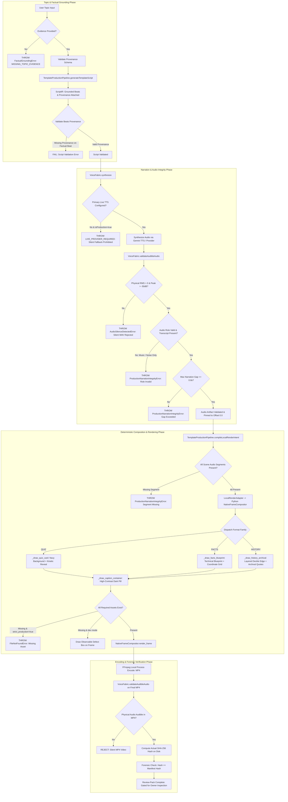
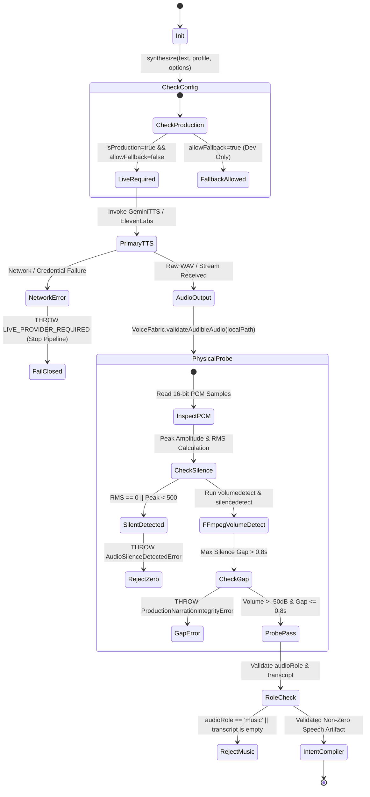
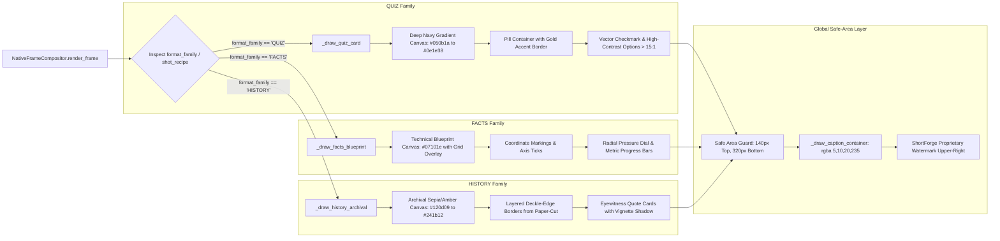

# ShortForge Production Pipeline Remediation: Final Architecture Diff

- **Document ID:** `FINAL-ARCHITECTURE-DIFF-20261031`
- **Branch:** `feat/shortforge-production-pipeline-repair-20261031`
- **Base Commit:** `cf4cc2c9eae81e4e835a1c6ee8d7bc579868a6af`
- **Scope:** Architectural and data-flow comparison across pipeline generations (Run 1 vs Run 2 vs Remediated).

---

## 1. Architectural Generation Comparison Matrix

| System Subsystem | Run 1 (Original Baseline) | Run 2 (Intermediate Qualification) | Remediated ShortForge Pipeline (P0 Fixed) |
| :--- | :--- | :--- | :--- |
| **Narration Engine Defaults** | Attempted network TTS; uncaught exceptions broke pipelines. | Added `SilentWavVoiceEngine` as silent fallback; silently created 0-sample WAV containers. | **Strict Live TTS Requirement**: Silent fallback disabled by default. Throws `LIVE_PROVIDER_REQUIRED`. Explicit opt-in only. Rejects music/noise artifacts without transcripts. |
| **Audio Verification** | Container stream check only (`has audio stream == PASS`). | Container format checks only; false green on zero-sample silent WAVs. | **Physical PCM & FFmpeg Verification**: Binary inspection of 16-bit PCM samples (peak, RMS) + FFmpeg `volumedetect`. Rejects $\text{RMS}=0$. |
| **Narration Continuity** | Unchecked timeline offsets; drift between scenes. | Scene audio clips had undefined source-in offsets. | **Deterministic Lowering & Alignment**: Every scene audio track strictly pinned to `start_seconds: 0.0`, `source_in_seconds: 0.0`. Missing scene audio segments throw `ProductionNarrationIntegrityError`. |
| **Content Grounding** | Hardcoded claims: 84% unreplicable phenomena, 10x lithium density, modern astrophysics. | Still contained hardcoded strings; default topic inputs fell back to hardcoded text. | **Evidence Provenance Contract**: Strict input schemas (`FactsEvidenceInputs`, `QuizEvidenceInputs`, `HistoryEvidenceInputs`). Beats missing provenance fail closed. Zero topic leakage. |
| **Visual Framing** | Identical generic layout across formats. | Added unconditional purple orb `(70, 30, 110, 60)` to opaque scenes. | **Three Distinct Composition Families**: `QUIZ` (Navy/Gold cards), `FACTS` (Blueprint HUD grids), `HISTORY` (Archival amber borders). Orb strictly composition-controlled. |
| **Missing Visual Assets** | Replaced missing assets with generic text cards silently. | Rendered generic cards; asset failure was invisible to viewers. | **Observable Defect & Strict Production Gate**: Missing assets render observable warning on-frame in dev (`[OBSERVABLE DEFECT: MISSING ASSET]`) and throw `FileNotFoundError` in strict production. |
| **Captions & Safe Areas** | Raw text without background; low contrast on light backgrounds. | Basic text rendering with potential clipping. | **Dedicated Caption Container**: High-contrast dark pill (`rgba(5, 10, 20, 235)`), contrast $>15:1$, with $140\text{ px}$ top and $320\text{ px}$ bottom safe areas. |
| **Typography & Symbols** | Missing fonts caused `?` glyphs for checkmarks and quotes. | Font fallback issues on Unicode characters. | **Sanitized Unicode & Vector Primitives**: Checkmarks drawn via native vector paths; quotes/dashes normalized via `_sanitize_unicode()`. |
| **External Template Reuse** | None. | Cloned repos into `vendor/`, but adaptations were incomplete. | **Clean-Room Deterministic Lowering**: Mapped motion timing & styling from `RenderComp`, `procedural-film`, and `Paper-Cut` directly into native compositor. |

---

## 2. End-to-End Pipeline Data Flow

---

## 3. VoiceFabric State Machine & Production Gating

---

## 4. Visual Family & Compositor Dispatch Hierarchy

---

## 5. Summary of Architectural Invariants Enforced

1. **Deterministic Audio Honesty**: An audio stream header is no longer accepted as proof of speech. Audio must have non-zero RMS energy and peak amplitude verified at both intermediate WAV and final MP4 container stages. Ambient noise and music tracks without speech transcripts/alignments are rejected.
2. **Deterministic Factual Grounding**: No AI model or template generator may output topic-independent claims. Every statistic and historical quotation must originate from a verified `provenance` record.
3. **Deterministic Visual Distinction**: Quiz, Facts, and History must never share identical background styling or visual layouts. Missing required assets block production rendering under `strict_production: true`.
4. **Clean-Room License Boundary**: External templates (`RenderComp`, `procedural-film`, `Paper-Cut`) are adapted cleanly into ShortForge's native deterministic compositor without importing unverified third-party binaries or assets.
5. **Fail-Closed Verification Gates**: Missing credentials, zero-sample audio, missing evidence, missing narration segments, or hash mismatches immediately halt the production pipeline.
