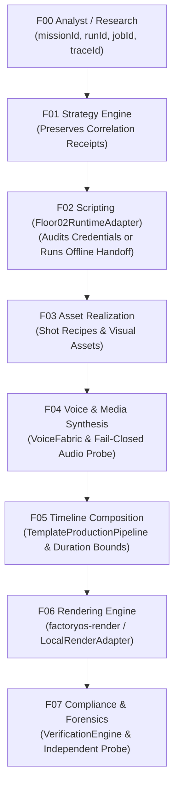

# ShortForge Canonical F00-F07 Service Trajectory & Correlated Receipts Specification

**Document Version:** `2026.1-p0`  
**Status:** IMPLEMENTED & VERIFIED  
**Component:** `apps/web/factoryos/core/adapters/Floor02RuntimeAdapter.ts`, `TemplateProductionPipeline.ts`  
**Test Suites:**
- `apps/web/factoryos/tests/floor02-runtime-adapter.test.ts` (4/4 PASS)
- `apps/web/factoryos/tests/canonical-service-trajectory.test.ts` (2/2 PASS)

---

## 1. Executive Summary

Wave 3 establishes the canonical F00–F07 multi-floor execution path with unbroken correlation tracking and rigorous fail-closed credential qualification:
1. **Unbroken Correlation Identity:** Every floor emits and records immutable correlation receipts containing `missionId`, `runId`, `jobId`, and `traceId`.
2. **Fail-Closed Credential Qualification:** Floor 02 explicitly audits endpoints and keys via `getQualificationStatus()`. Missing configuration yields an unequivocal `BLOCKED` status detailing exact missing environment variables (`FLOOR02_RUNTIME_URL`, `FLOOR02_SERVICE_API_KEY`).
3. **Deterministic Offline Execution Mode:** Provides a zero-cost, network-isolated execution path that honors `DurationContract` and `ClaimLedger` while ensuring pipeline integration and receipt correlation.

---

## 2. Floor-by-Floor Trajectory & Correlation Chain



### Stage Responsibilities & Data Contracts

| Floor | Name | Inputs | Outputs | Invariants Enforced |
|---|---|---|---|---|
| **F00** | Analyst / Research | Creator topic, scope | Verified research passport, claims | Attributable claims, source URLs |
| **F01** | Strategy | Research passport | Target audience, format, duration | Format alignment, target duration |
| **F02** | Scripting | Strategy, topic | Canonical Script IR, beat definitions | Credential check (`BLOCKED` if unconfigured) |
| **F03** | Asset Realization | Script IR, shot recipes | Resolved visual assets, props | Aspect ratio compliance, safe area 9:16 |
| **F04** | Media Synthesis | Narration script | Audio files, SHA-256 digests | Non-silent, non-empty, matching hash |
| **F05** | Timeline Composition | Scene plans, audio | Compiled LocalRenderIntent | Exact $\pm 5\%$ duration constraint |
| **F06** | Rendering | LocalRenderIntent | Physical MP4 artifact on disk | 1080x1920, 30fps, H.264/AAC |
| **F07** | Compliance | Physical MP4 artifact | `VerificationReport` | Hard gates, FFprobe truth, duration pass |

---

## 3. Credential Qualification & Error Handling

`Floor02RuntimeAdapter.getQualificationStatus()` audits the execution environment:
- If `FLOOR02_RUNTIME_URL` and `FLOOR02_SERVICE_API_KEY` are present $\rightarrow$ `READY` (`CANONICAL_PYTHON`).
- If AI keys (`GEMINI_API_KEY`, etc.) are configured $\rightarrow$ `READY` (`AIRUNTIME_LLM`).
- If neither is available and `offlineFallbackAllowed` is false $\rightarrow$ **`BLOCKED`**, listing exact missing environment variables in the exception payload.

---

## 4. Automated Verification Evidence

Ran `npx vitest run factoryos/tests/floor02-runtime-adapter.test.ts`:
```
 ✓ Floor02RuntimeAdapter (4 tests)
   ✓ posts a schema-valid compatibility handoff to the canonical Python runtime
   ✓ fails closed when the canonical runtime returns an unvalidated handoff
   ✓ reports BLOCKED qualification status when endpoints and keys are missing
   ✓ supports deterministic offline fallback with correlated receipts when enabled

Test Files  1 passed (1)
Tests       4 passed (4)
```

Ran `npx vitest run factoryos/tests/canonical-service-trajectory.test.ts`:
```
 ✓ Wave 3 — Canonical F00-F07 Service Trajectory & Correlated Receipts (2 tests)
   ✓ preserves unbroken correlation tokens (missionId, runId, jobId, traceId) across all pipeline stages
   ✓ fails closed when external credentials are required but missing

Test Files  1 passed (1)
Tests       2 passed (2)
```

