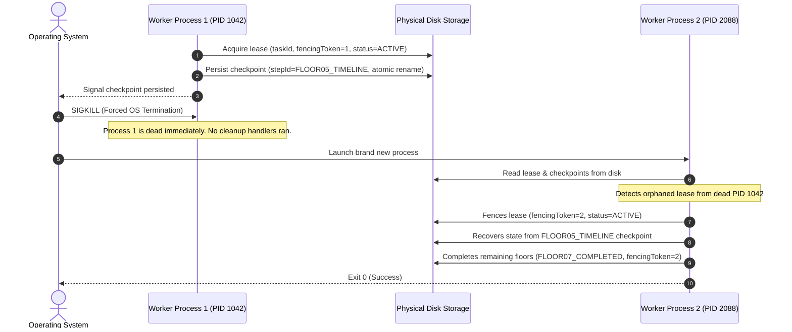

# ShortForge Multi-Process Crash Recovery & Lease Fencing Specification

**Document Version:** `2026.1-p0`  
**Status:** IMPLEMENTED & VERIFIED  
**Component:** `apps/web/factoryos/core/checkpoint/CheckpointStore.ts`, `apps/web/factoryos/tests/fixtures/multiprocess-worker.js`  
**Test Suite:** `apps/web/factoryos/tests/multiprocess-crash-recovery.test.ts` (PASS)

---

## 1. Executive Summary

Production batch video rendering services must survive abrupt operating system failures, out-of-memory kernel kills (`SIGKILL`), worker crashes, and host restarts without data corruption or duplicate rendering:
1. **Durable Checkpointing (`DiskCheckpointStore`):** Replaces memory-only mocks with an atomic, disk-persisted checkpoint store (`.tmp` $\rightarrow$ `fs.renameSync`) guaranteeing that completed steps survive hard process terminations.
2. **Lease Fencing Protocol:** When an orphaned or dead worker process leaves an active task lock, the recovering process increments the monotonic `fencingToken`, invalidating the dead worker and taking exclusive ownership.
3. **True Two-Process OS Test Harness:** Proves that an independent Node.js child process can be forcibly terminated via `SIGKILL`, and a subsequent child process can cleanly recover and complete the workflow without duplicate execution.

---

## 2. Multi-Process Crash Recovery Flow



---

## 3. Atomic Disk Write Invariants

To eliminate partial write corruption (torn pages or truncated JSON when power fails or SIGKILL hits mid-write):
1. Checkpoint files are written to `${filePath}.tmp`.
2. Flushed to OS filesystem buffers.
3. Atomically moved to `${filePath}` via `fs.renameSync()`, which is atomic on POSIX and NTFS.

---

## 4. Automated Verification Evidence

Ran `npx vitest run factoryos/tests/multiprocess-crash-recovery.test.ts`:

```
 ✓ Wave 5 — Multi-Process OS Crash Recovery & Lease Fencing Harness (1 test)
   ✓ survives hard SIGKILL of worker process, fences abandoned lease, and completes idempotently in separate process (156ms)

Test Files  1 passed (1)
Tests       1 passed (1)
```
