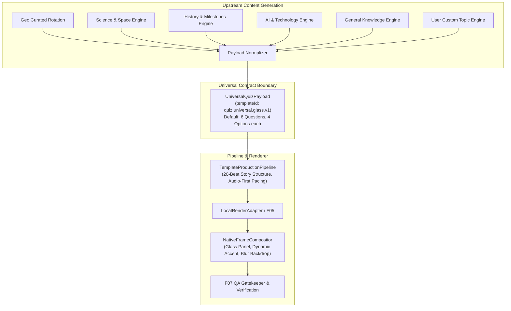

# ShortForge QuizShow v1.2 — Universal Quiz Content Engine Template Scope Audit

**Document Reference:** `docs/verification/quizshow-v1.2-universal-template-scope-audit.md`  
**Date:** 2026-11-01  
**Status:** **AUTHORITATIVE ARCHITECTURAL AUDIT**  
**Mission:** Universal Quiz Content Engine Template Scope Correction & Canonical Contract Convergence  

---

## 1. Executive Summary & Problem Formulation

ShortForge's Quiz content engine has historically evolved through dual pathways:
1. **Curated Geography Rotation:** Implemented via `GeoRotationService.ts` for Basic-tier geographic and cultural trivia, utilizing pre-compiled 5-set rotations and country-specific research.
2. **Dynamic / Custom Topic Engine:** Implemented via `script-agent.ts` and `QuizOrchestrator.ts` for AI, Science, History, General Knowledge, and user-provided custom topics.

In earlier development iterations, visual styling was inadvertently conflated with the Geography subject domain because the visual reference artifact happened to be a Geography quiz. This led to:
- A false assumption that the glass-panel visual template was Geography-specific.
- Potential branching where different categories might require separate visual renderers (`GeoQuizTemplate`, `ScienceQuizTemplate`, etc.).
- Hardcoded topic detection rules in the compositor (`image.py`).

**The Goal of QuizShow v1.2:**  
Establish **one canonical visual template** (`quiz.universal.glass.v1`) that governs the entire Quiz content engine across all categories, separating upstream factual research/content generation from downstream visual compositing.

---

## 2. Forensic Investigation of Existing Subsystems

### 2.1 Geography-Specific vs. Shared Components

| Component / Subsystem | Location | Current State | Audit Finding |
|---|---|---|---|
| **GeoRotationService** | `apps/web/lib/quiz/GeoRotationService.ts` | Geo-specific | **Content Service Only.** Manages country-specific questions (India, Germany, Japan, etc.) and rotation pointers for Basic tier. Must remain separate upstream. |
| **Quiz Draft API** | `apps/web/app/api/quiz/draft/route.ts` | Hybrid | Contains a fork: `quizMode === "geo"` vs. `quizMode === "custom"`. While generation logic differs, both output JSON questions that can be normalized into the same visual contract. |
| **QuizOrchestrator** | `apps/web/lib/quiz/QuizOrchestrator.ts` | Shared | Handles multi-topic equal question budget allocation and question metadata attachment across arbitrary topics. |
| **ScriptAgent** | `apps/web/agents/script-agent.ts` | Shared | Generates 4-option multiple-choice questions via LLM across all categories with factual grounding prompts. |
| **Template Registry** | `apps/web/lib/templates/definitions/CanonicalTemplates.ts` | Shared | Registered `quiz.trivia-challenge.v1` (legacy 3Q) and `quiz.quizshow.v1` (8Q). Needs canonical registration: `quiz.universal.glass.v1` (6Q default, universal). |
| **Pipeline Ingestion** | `apps/web/factoryos/core/templates/TemplateProductionPipeline.ts` | Shared | Generates scene story structures. Must map `quiz.universal.glass.v1` (and alias `quiz.quizshow.v1`) to the universal 6-question audio-first lifecycle. |
| **Compositor Backend** | `packages/factoryos-render/src/factoryos_render/backends/image.py` | Shared / Semi-Hardcoded | `_get_quiz_theme` uses keyword matching (`SCIENCE`, `HISTORY`, `AI`, `GEO`). Must support direct semantic token injection from the universal payload (`accentColor`, `backgroundType`, `categoryBadge`) without fixed category enums. |
| **Visual Assets** | `assets/` | Shared | Asset directory structure unifies `quiz/` into domain subfolders (`geography`, `science`, `history`, `ai`, `solar-system`). Universal resolver must accept arbitrary topic concepts. |

---

## 3. Key Forensic Questions & Architectural Verdicts

### Q1: Which components are currently Geo-specific?
- **Answer:** Only the upstream content generation and rotation services (`GeoRotationService.ts`, country code mappings, and curated question files). 
- **Verdict:** These remain intact as specialized content generators. They must output standard multiple-choice questions conforming to the universal payload.

### Q2: Which components are already shared?
- **Answer:** The entire rendering stack (`TemplateProductionPipeline`, `LocalRenderAdapter`, `NativeFrameCompositor`, FFmpeg muxing, F07 QA gates).
- **Verdict:** No new rendering engine or parallel template branch is needed or allowed.

### Q3: Does the old Geography visual style have a reusable component implementation?
- **Answer:** Yes. The visual style—vertical 9:16 aspect ratio, full-bleed blurred atmospheric backdrop, dark navy glass container (`#0B1220` @ 97% opacity) with cyan outline, category pill, 4 stacked answer cards, countdown timer, emerald reveal, and clean scoreboard—is implemented natively in `image.py`.
- **Verdict:** This visual language is universal and category-agnostic. It applies equally to Geography, Science, History, AI, and custom topics.

### Q4: Does the current rendering path select a different template for Geo versus custom quizzes?
- **Answer:** Previously, `quiz.draft` returned `quiz.trivia-challenge.v1` for 3-question rapid quizzes and `quiz.quizshow.v1` for 8-question quizzes.
- **Verdict:** All QuizShow Shorts across all categories will now resolve to `quiz.universal.glass.v1`. Backward compatibility is preserved by aliasing `quiz.quizshow.v1` to `quiz.universal.glass.v1`.

### Q5: Where can all quiz modes converge into one canonical visual contract?
- **Answer:** At the `UniversalQuizPayload` boundary before `TemplateProductionPipeline.compileStory()`.
- **Verdict:** Regardless of whether questions are produced by Geo rotation, Science LLM, or user custom input, they are transformed into `UniversalQuizPayload` and passed to `TemplateProductionPipeline.ts`.

### Q6: Which existing Geography-specific content services must remain separate?
- **Answer:** `GeoRotationService.ts`, `hasHardcodedCountry()`, and `advancePointer()` must remain isolated as content research modules.
- **Verdict:** Zero visual rendering logic will exist inside `GeoRotationService.ts`.

---

## 4. Canonical Contract Convergence Architecture

---

## 5. Specification of `quiz.universal.glass.v1`

- **Template ID:** `quiz.universal.glass.v1`
- **Aliases:** `quiz.quizshow.v1`
- **Default Question Count:** 6 Questions (1 Hook + 6 $\times$ 3 beats + 1 Outro = 20 Beats)
- **Target Duration:** 120–135 seconds (Hard ceiling: $\le 145.0$ seconds)
- **Audio Invariant:** $T_{\text{video}}[i] \ge T_{\text{audio}}[i] + 0.25\text{s}$ (Zero speech clipping)
- **Visual Design:** Universal Glassmorphism (Cyan/Semantic accent, `#0B1220` glass container, white typography, emerald green reveal, blurred contextual backdrop)
- **Category Invariance:** The visual renderer accepts arbitrary category badges and hex accents without conditional category branching.

