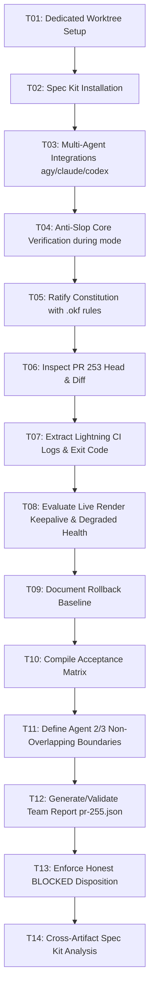

# Task Ledger: 001-release-readiness-gate

**Branch**: `feat/release-sdlc-spec-kit-20261029`  
**Feature**: `specs/001-release-readiness-gate`  
**Status**: Ready / Verified  
**Owner**: Agent 1 (Release Captain, Spec Kit & SDLC)  

---

## Task Dependencies & Order

---

## Phase 1: Setup & SDLC Preflight

- [x] **T01**: Create dedicated worktree `ShortForge-agent1-sdlc` on branch `feat/release-sdlc-spec-kit-20261029` from `origin/main` (`cf4cc2c9`).
- [x] **T02**: Install Spec Kit using official existing-project adoption docs (`specify init --here --force --non-interactive --integration claude`).
- [x] **T03**: Install multi-agent integrations for Codex (`codex`) and Antigravity (`agy`). Verify with `specify integration list`.
- [x] **T04**: Verify Anti-Slop core v3.2.20 in mode `during` (session override + `%APPDATA%\antislop\settings.json`).
- [x] **T05**: Ratify `.specify/memory/constitution.md` additively with `.okf` laws (`Claim <= Evidence`, `Decoupled Hierarchy`, `Error Honesty`, `Bounded Repair`).

## Phase 2: Forensic Inspection of PR #253 & Live Environment

- [x] **T06**: Fetch and inspect PR #253 head commit `0e733960dc034a4b07c2e94c6c0a1f08bd2ded67` (`fix/production-readiness-smoke-gates-20261029`).
- [x] **T07**: Inspect GitHub Actions run `40824025739` on `Lightning Physical MP4 Render Proof`. Extract failure logs: Step 11 exited with code 1 (`Authentication failed: Please run lightning login`). Confirm 0 proof artifacts.
- [x] **T08**: Inspect live Render keepalive run `40804889047`. Confirm HTTP 200 with application status `degraded` due to missing Google Drive key path and YouTube refresh token.
- [x] **T09**: Verify deployed container commit `cf4cc2c9` on Node 20 runtime. Establish rollback baseline at `cf4cc2c9eae81e4e835a1c6ee8d7bc579868a6af`.

## Phase 3: Acceptance Matrix & Multi-Agent Coordination

- [x] **T10**: Compile multi-dimensional acceptance matrix covering Spec Kit, Anti-Slop, Node runtime, health probe, live readiness, physical rendering, and merge gate.
- [x] **T11**: Establish agent boundaries: Agent 1 (SDLC/Spec), Agent 2 (Workers/Pipeline on `feat/worker-render-pipeline-20261029`), Agent 3 (UI on `feat/ui-readiness-dashboard-20261029`).
- [x] **T12**: Define integration order: Agent 1 SDLC gate → Agent 2 worker real-render proof → Agent 3 UI integration → controlled staging verification → Release Captain sign-off.

## Phase 4: Team Change Report & Gate Validation

- [x] **T13**: Create `Team/reports/pr-255.json` for this Agent 1 PR (schema version 1.0); keep PR #253's report scoped to PR #253.
- [ ] **T14**: Execute `node Team/scripts/validate-team-report.mjs Team/reports/pr-255.json` (pending CI/runner validation).
- [ ] **T15**: Verify validation output is `TEAM_CHANGE_GATE: VALID` with disposition `BLOCKED`; do not mark complete until the PR #255 report actually passes.

## Phase 5: Cross-Artifact Consistency Analysis

- [x] **T16**: Run cross-artifact consistency analysis across `spec.md`, `clarifications.md`, `plan.md`, `checklist.md`, and `tasks.md`.
- [x] **T17**: Confirm no orphan tasks, no unmapped requirements, and no boundary violations.
